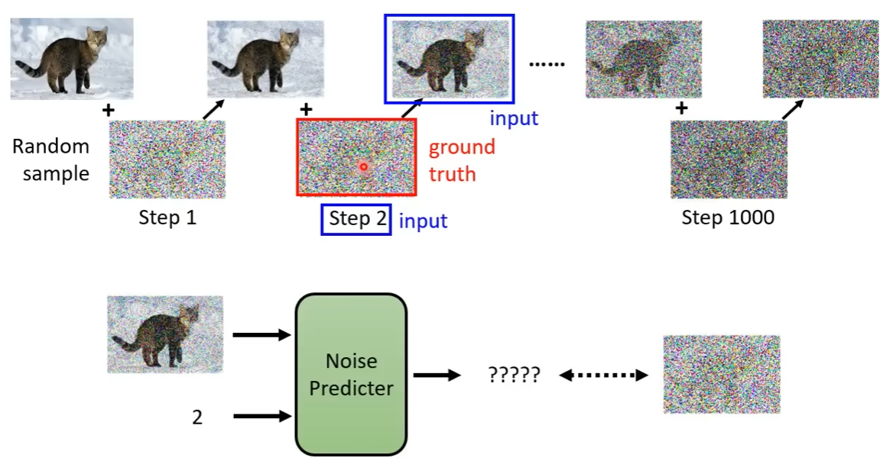
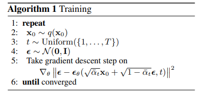
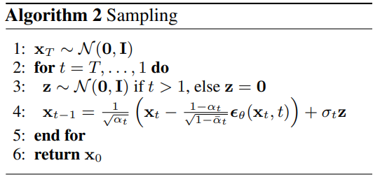
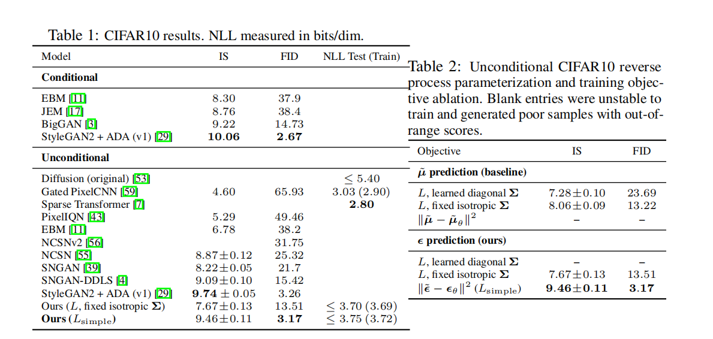
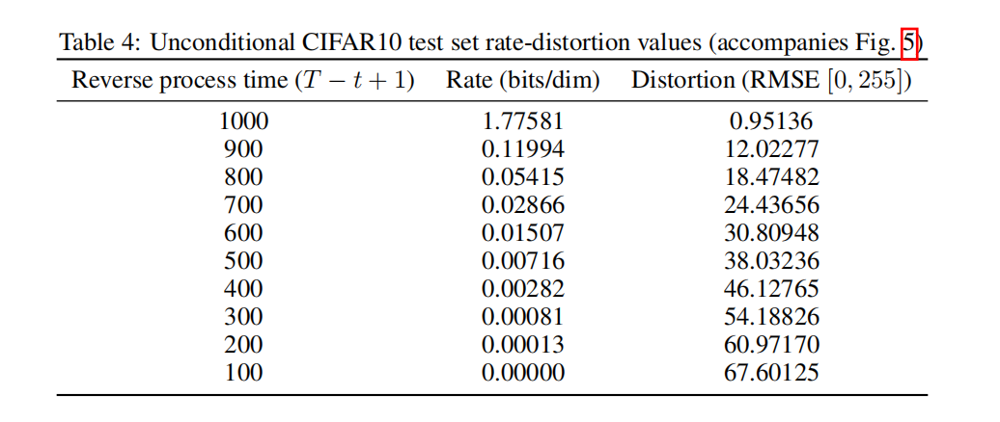
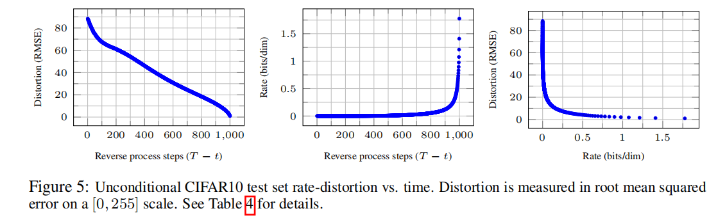
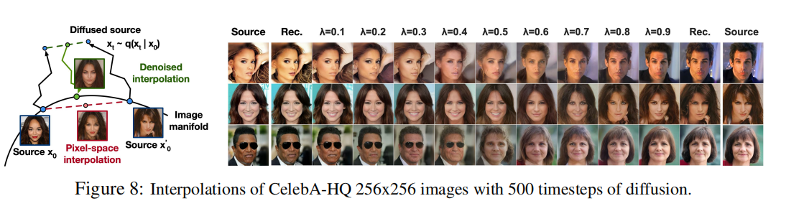
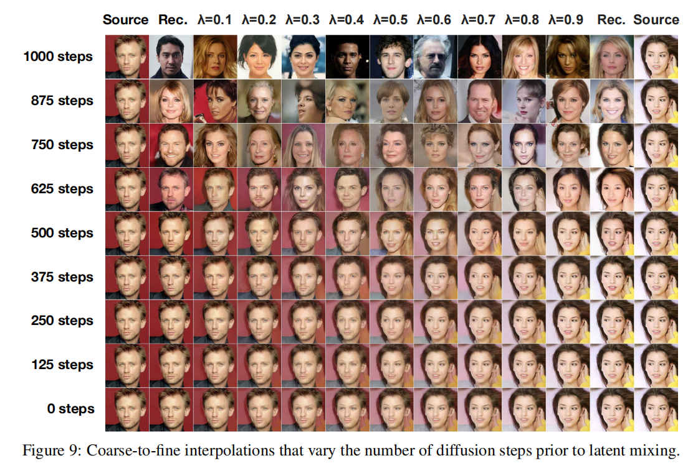

# 扩散模型（Diffusion Model）

## 介绍

扩散模型（Diffusion Model）是一种通过学习训练样本数据的**真实分布**，生成与训练样本接近的样本。扩散模型包括**前向传播**和**反向传播**。通过学习反转扩散的过程从噪声中构建样本。为了学习到反转扩散的过程，需要了解前向传播增加噪声的过程。**DDPM** 是扩散模型经典的论文。

## 前向传播

前向传播是一个加噪声的过程，该过程视为[马尔可夫过程](https://zh.wikipedia.org/wiki/%E9%A9%AC%E5%B0%94%E5%8F%AF%E5%A4%AB%E9%93%BE)，加入的噪声符合[高斯分布](https://zh.wikipedia.org/zh-sg/%E6%AD%A3%E6%80%81%E5%88%86%E5%B8%83)。从输入图像 $x_0$ 开始，经过 $t$ 个步数，得到 $x_t$ 时刻的包含噪声的图像。上一时刻的图像为 $x_{t-1}$。定义 $\beta_t$ 为前向传播过程中添加高斯噪声方差调整参数。$\alpha_t = 1 - \beta_t$。根据马尔可夫的性质，$x_t$ 时刻与 $x_{t-1}$ 时刻有关。定义如下公式：

$$
x_t = \sqrt{\alpha_{t}} \, x_{t-1} + \sqrt{1 - \alpha_t} \, \epsilon_{t-1}
$$

其中 $\epsilon$ 为添加的噪声项，符合高斯分布 $\epsilon \sim \mathcal{N}(0, I)$。在论文中，步数 $t$ 取 1000。$\beta_t$ 为线性递增策略，从 0.0001 递增到 0.02。为什么要这样做呢。因为在前期，图像分布均匀，只须加入少量的噪声就能改变其原始分布。而到后期，需要添加更多噪声才可以保持相同的噪声扩散分布。

向前推导，得到：

$$
x_{t-1} = \sqrt{\alpha_{t-1}} \, x_{t-2} + \sqrt{1 - \alpha_{t-1}} \, \epsilon_{t-2}
$$

带入上式简化得到

$$
x_t = \sqrt{\alpha_t \alpha_{t-1}} x_{t-2} + \left( \sqrt{\alpha_t (1 - \alpha_{t-1})} \epsilon_{t-2} + \sqrt{1 - \alpha_t} \epsilon_{t-1} \right)
$$

由于每一步所添加的噪声都符合$\epsilon \sim \mathcal{N}(0, I)$ ，由高斯分布的性质，括号里面的式子可以简化为

$$
x_t = \sqrt{\alpha_t \alpha_{t-1}} x_{t-2} + \sqrt{1 - \alpha_t \alpha_{t-1}} {\epsilon}_{t-2}
$$

根据归纳法，可以得到 $x_0$ 与 $x_t$ 的关系：

$$
x_t = \sqrt{\bar{\alpha}_t} x_0 + \sqrt{1 - \bar{\alpha}_t} \epsilon_t
$$

其中

$$
\bar{\alpha}_t = \alpha_t \alpha_{t-1} \dots \alpha_1
$$

因此，扩散模型在训练过程中实际上无需一步一步添加噪声，而是在数据分布中

- 选取一张图片 $x_0 \sim q(x_0)$ 

- 随机采样时间步 $t \sim \text{Uniform}(1, \dots, T)$

- 采样噪声$\epsilon \sim \mathcal{N}(0, I)$

直接生成得到。最终得到$q(x_{1:T} | x_0)$ ，$q(x_t|x_0) = \mathcal{N}(x_t; \sqrt{\bar{\alpha}_t}x_0, (1 - \bar{\alpha}_t)I)$ ，对应论文算法1部分。其中第五项 $\nabla_\theta \left\| \boldsymbol{\epsilon} - \boldsymbol{\epsilon}_\theta \left( \sqrt{\bar{\alpha}_t} \mathbf{x}_0 + \sqrt{1 - \bar{\alpha}_t} \boldsymbol{\epsilon}, t \right) \right\|^2$ 为用噪声预测器与真实噪声进行均方误差MSE的损失计算，随后求梯度进行参数的更新。

既然能一次生成图片，为什么还需定义多步的正向步骤呢，因为我们希望反向模型学会在不同噪声水平下逐渐去噪。正向过程提供了这些训练状态，也给出了一个结构简单、每一步都是高斯分布的概率模型。

## 反向传播

反向传播是从一张纯噪声图中逐步去噪得到干净的图片，这一过程是正向加噪的逆过程，与正向过程中设计的参数$\beta_t$ 有关。

首先从标准高斯分布$x_T \sim \mathcal{N}(0, I)$ ，正向加噪的过程中，当最终步$t=T$ 时，$x_T$ 接近纯噪声图片，符合标准高斯分布。反向过程中，我们希望能够从$x_T$ 估计原始图片$x_0$， 由上述公式得到$x_{0}$ 与$x_t$ 的关系：

$$
x_0= \frac{x_t-\sqrt{1-\bar\alpha_t}\epsilon} {\sqrt{\bar\alpha_t}}
$$

但是在生成过程中，我们并不知道真实的噪声 $\epsilon$ ，所以使用神经网络预测

$$
\epsilon\approx\epsilon_\theta(x_t,t)
$$

于是原始图片估计值

$$
x_0= \frac{x_t-\sqrt{1-\bar\alpha_t}\epsilon_\theta(x_t,t)} {\sqrt{\bar\alpha_t}}
$$

为了得到$q(x_{t-1}|x_t)$ ，在推导训练过程中，我们可以使用已知的当前图片$x_T$和$x_{0}$ 来求出后验分布$q(x_{t-1}\mid x_t,x_0)$ ，根据贝叶斯公式：

$$
q(x_{t-1} \mid x_t, x_0) = \frac{q(x_t \mid x_{t-1})q(x_{t-1} \mid x_0)}{q(x_t \mid x_0)}
$$

整理公式带入前面前向推导的各式，具体过程可看论文[arXiv:2208.11970](https://arxiv.org/abs/2208.11970)，可以得到$q(x_{t-1}\mid x_t,x_0)$ 后验均值方差满足：

$$
\tilde{\mu}_t = \frac{1}{\sqrt{\alpha_t}} \left( x_t - \frac{\beta_t}{\sqrt{1 - \bar{\alpha}_t}} \epsilon \right)
$$

$$
\tilde{\beta}_t = \frac{1 - \bar{\alpha}_{t-1}}{1 - \bar{\alpha}_t} \cdot \beta_t
$$

生成时没有真实的 $x_0$，也就不知道真实噪声 $\epsilon$。$μ_θ$​ 必须去预测上面这个 $\tilde{\mu}_t$，而其中 $x_t$​ 是网络输入、已知的，唯一未知的是 *ϵ*。所以我们用网络预测的噪声替换上式中的真实噪声，定义反向分布的均值：

$$
\mu_\theta(x_t,t)=
\frac{1}{\sqrt{\alpha_t}}
\left(
x_t-\frac{\beta_t}{\sqrt{1-\bar\alpha_t}}
\epsilon_\theta(x_t,t)
\right)
$$

使用神经网络$p_\theta(x_{t-1}|x_t)$ 拟合逆向过程 $q(x_{t-1}|x_t)$满足分布

$$
p_\theta(x_{t-1} \mid x_t) = \mathcal{N} \left( x_{t-1}; \mu_\theta(x_t, t), \sigma_t^2 I \right)
$$

在论文中，高斯分布的方差直接取值为$\beta_t$ ，因此只有均值是需要网络去估计的。使用高斯的重参数化形式：

$$
x_{t-1} = \mu_\theta(x_t, t) + \sigma_t z
$$

其中，反向过程的随机噪声项用于辅助生成更清晰的样本

$$
z \sim \mathcal{N}(0, I)
$$

对应论文中的算法2

为什么生成噪声图片可以一步生成，去噪却还是需要多步呢，一步去噪在数学上并非不可能，但模型要学习如何从简单的噪声分布逐渐生成复杂的真实数据分布。 这是一种有效的建模和训练策略。

## 损失训练

知道了扩散模型前向和反向传播的过程，那么如何训练扩散模型来获得模型的均值呢？

在已知训练数据样本的情况下，要反向的求模型的参数，我们要找到

$$
\theta^* = \arg\max_\theta \prod_{i=1}^N p_\theta(x_0^{(i)})
$$

的最大值，对其取对数，也就是求

$$
\theta^* = \arg\max_\theta \sum_{i=1}^N \log p_\theta(x_0^{(i)})
$$

最大似然估计。最大化模型的对数似然，从Loss损失的角度就是最小化负对数似然。

$$
\mathcal{L}_{\text{NLL}} = - \sum_{i=1}^N \log p_\theta(x_0^{(i)})
$$

在实际训练中，我们没有真实分布 $q$的完整表达式，只有有限的数据集。因此用样本平均来近似期望用样本平均来近似期望

$$
\mathcal{L} \approx -\frac{1}{N} \sum_{i=1}^N \log p_\theta(x_0^{(i)})
$$

$$
\mathcal{L} = \mathbb{E}_q[-\log p_\theta(x_0)]
$$

但是在生成真实图片的过程中，会经过多个中间的隐变量。在训练过程中，只有真实的图片$x_0$ ，并没有一条已经存在的反向生成轨迹。我们最终希望得到生成图片$x_0$ 的概率密度最大。因此计算$p_\theta(x_{0})$ 时，需要将整个隐藏状态考虑进去。给定起点噪声分布$x_T$ ，DDPM将反向过程建模定义为：

$$
p_\theta(x_{0:T}) = p(x_T) \prod_{t=1}^T p_\theta(x_{t-1} \mid x_t)
$$

$$
p_\theta(x_0) = \int p_\theta(x_{0:T}) \, dx_{1:T}
$$

我们面对的是一个极高维度的积分，通常不能直接算出 $p_\theta(x_0)$的精确值。虽然在数学上完全正确，却不能直接作为一个简单的训练算法。论文中采用了变分下界ELBO的思想。假设我们想知道一个数 $A$，但是直接计算它很困难。如果我们能找到一个容易计算的数 $B$，并且保证

$B\leq A$，那么  $B$就是$A$的一个下界。

扩散模型可以看作是一个多层的VAE。扩散模型想要优化的问题同VAE相似。VAE 引入一个潜变量 $z$，希望用它描述与图片有关的潜在因素。因为

$$
\int q_\phi(z \mid x) \, dz = 1
$$

所以优化的目标$log p_\theta(x)$可以改写为

$$
\log p_\theta(x) = \int q_\phi(z \mid x) \log p_\theta(x) \, dz
$$

由全概率公式$p_\theta(z, x) = p_\theta(z \mid x)p_\theta(x)$，上式可改写为

$$
\log p_\theta(x) = \int q_\phi(z \mid x) \log \left( \frac{p_\theta(z, x)}{p_\theta(z \mid x)} \right) dz
\\[8pt] 
=\int q_\phi(z \mid x) \log \left( \frac{p_\theta(z, x)q_\phi(z \mid x)}{q_\phi(z \mid x)p_\theta(z \mid x)} \right) dz
\\[8pt]
=\begin{aligned}
& \int q_\phi(z \mid x) \log \frac{p_\theta(z, x)}{q_\phi(z \mid x)} dz 
& + \int q_\phi(z \mid x) \log \frac{q_\phi(z \mid x)}{p_\theta(z \mid x)} dz
\end{aligned}
$$

根据KL散度的定义：

$$
D_{\text{KL}} (q_\phi(z \mid x) \parallel p_\theta(z \mid x)) = \int q_\phi(z \mid x) \log \frac{q_\phi(z \mid x)}{p_\theta(z \mid x)} dz
$$

由KL散度的性质$D_{\text{KL}}(q \parallel p) > 0$，最终可将目标$log p_\theta(x)$ 改写成：

$$
\begin{aligned}
\log p_\theta(x) = & \underbrace{\mathbb{E}_{q_\phi(z|x)} \left[ \log \frac{p_\theta(z, x)}{q_\phi(z \mid x)} \right]}_{\text{ELBO}} \\
& + \underbrace{D_{\text{KL}} (q_\phi(z \mid x) \parallel p_\theta(z \mid x))}_{\ge 0}
\end{aligned}
$$

$$
\log p_\theta(x) \ge \mathbb{E}_{q_\phi(z|x)} \left[ \log \frac{p_\theta(z, x)}{q_\phi(z \mid x)} \right]
$$

问题转化为优化ELBO，ELBO的式子仍然难以理解，我们对其进行变形，变成更容易理解的形式：

$$
\begin{aligned}
\text{ELBO}(x) &= \mathbb{E}_{q_\phi(z|x)} \left[ \log \frac{p_\theta(x \mid z)p(z)}{q_\phi(z \mid x)} \right] \\[8pt]
&= \mathbb{E}_{q_\phi(z|x)}[\log p_\theta(x \mid z)] \\[8pt]
&\quad - D_{\text{KL}}(q_\phi(z \mid x) \parallel p(z))
\end{aligned}
$$

训练时，VAE最大化ELBO,等价于最小化负ELBO，从而近似最小化负似然对数。前面提到扩散模型可视为多层的VAE，VAE中的$z$为隐藏的中间量。将扩散模型中做一个替换：

$$
z \longrightarrow x_{1:T}\\
q_\phi(z \mid x) \longrightarrow  q(x_{1:T} \mid x_0) \\
 p_\theta(x, z) \longrightarrow 
 p_\theta(x_{0:T})
$$

在 VAE 中，联合分布分解为：

$$
p_\theta(x, z) = p_\theta(x|z)p(z)
$$

在 DDPM 中，联合分布分解为：

$$
p_\theta(x_{0:T}) = p_\theta(x_T) \prod_{t=1}^T p_\theta(x_{t-1}|x_t)
$$

经过这么多变换，DDPM的变分下界ELBO就变成了

$$
\text{ELBO}_{\text{DDPM}}(x_0) = \mathbb{E}_{q(x_{1:T}|x_0)} \left[ \log \frac{p_\theta(x_{0:T})}{q(x_{1:T} \mid x_0)} \right]
$$

最小化$-ELBO$，经过一系列推导，具体可看[arXiv:2208.11970](https://arxiv.org/abs/2208.11970) ，最终得到：

$$
L_{\text{VLB}} = \mathbb{E}_{q(\mathbf{x}_{0:T})} \left[ \log \frac{q(\mathbf{x}_{1:T}|\mathbf{x}_0)}{p_\theta(\mathbf{x}_{0:T})} \right]
\\=
\mathbb{E}_q \left[ \underbrace{D_{\text{KL}}(q(\mathbf{x}_T|\mathbf{x}_0) \parallel p_\theta(\mathbf{x}_T))}_{L_T} 
+ \sum_{t>1} \underbrace{D_{\text{KL}}(q(\mathbf{x}_{t-1}|\mathbf{x}_t, \mathbf{x}_0) \parallel p_\theta(\mathbf{x}_{t-1}|\mathbf{x}_t))}_{L_{t-1}} - \underbrace{\log p_\theta(\mathbf{x}_0|\mathbf{x}_1)}_{L_0} \right]
$$

那么我们在训练过程中需要以什么作为我们的训练目标呢，我们对三项做分析。

对于$L_T$，在前向和反向传播的推导中，已知了$q(x_T\mid x_0)$ 由初始参数$\beta$决定，$p(x_T)=\mathcal N(0,I)$，因此，$L_T$ 只是两个已知高斯分布之间的 KL 散度。在训练过程中无法对其学习更新。对于$L_0$，DDPM文中使用简化目标替代整个变分下界，用$L_{simplpe}$近似包括 $L_0​$在内的所有重建目标。

对于$L_{t-1}$，在前面的推导中，已知了$q(x_{t-1}\mid x_t,x_0)$ 和$p_\theta(x_{t-1}|x_t)$均满足高斯分布。则他们的KL散度为

$$
D_{\text{KL}}(q \parallel p) = \log \frac{\sigma_p}{\sigma_q} + \frac{\sigma_q^2 + (\mu_q - \mu_p)^2}{2\sigma_p^2} - \frac{1}{2}
$$

因为在给定参数$\beta$，两者的方差均为常数，所以优化目标就是两个分布均值的二范数期望是线性的，所以问题优化成：

$$
L_{t-1} = \mathbb{E}_q \left[\|\tilde{\mu}_t - \mu_\theta(x_t, t)\|_2^2 \right]
$$

反向传播时得知两者均值的代数式，问题可优化为：

$$
\mathcal{L}_{\text{simple}} = \mathbb{E} \left[ \|\epsilon - \epsilon_\theta(x_t, t)\|_2^2 \right]
$$

这就是训练时最终需要优化的结果。

## 网络框架设计

DDPM使用一个共享参数的时间条件 U-Net 来参数化反向过程的噪声预测器 $ϵ_θ​(x_t​,t)$，U-Net网络输入的是某一时刻的图片$x_t$和该时刻的时间$t$，输出的是对噪声的预测。

待完善。

## 实验结果分析

那么我们如何评估一个生成模型的好坏呢。DDPM使用以下指标：

**Inception Score (IS)**：IS 的计算使用一个预训练的 Inception 分类网络衡量生成图像是否具有清晰、可识别的语义类别，同时生成的图像是否具有足够的类别多样性。

设生成图像为 $x$，网络对其类别的预测分布为 $p(y\mid x)$，所有生成图像的平均类别分布为 $p(y)$，则：

$$
\text{IS} = \exp \left( \mathbb{E}_x [D_{\text{KL}} (p(y \mid x) \parallel p(y))] \right)
$$

数值越高越说明生成图像的类别预测和生成所有图像的平均分布越远。它偏向于“清晰且多样”的样本。

**FID (Fréchet Inception Distance)**：FID 将真实图像和生成图像输入预训练的 Inception 网络，提取特征，然后分别用高斯分布近似这些特征的统计分布。比较生成图像与真实图像在 Inception 特征空间中的分布差异（均值和协方差的高斯假设下的 Fréchet 距离）。

设真实图像特征的均值和协方差为$(\mu_r, \Sigma_r)$，生成图像特征的均值和协方差为 $(\mu_g, \Sigma_g)$，FID 定义为：

$$
\begin{aligned}
\text{FID} &= \|\mu_r - \mu_g\|_2^2 \\
&\quad + \text{Tr} \left( \Sigma_r + \Sigma_g - 2(\Sigma_r \Sigma_g)^{1/2} \right)
\end{aligned}
$$

生成图像的特征分布与真实图像的特征分布相差越小越好。

**NLL (Negative Log-Likelihood) / bits/dim，单位bits/dim**：无损编码长度，即模型对真实数据分配的负对数似然。越低越好，衡量的是“无损压缩”能力。

**Rate-Distortion（率-失真）**：把变分下界各项看作“码率”（rate，bits/dim）和“失真”（distortion，RMSE，在 [0,255] 尺度上）。用于分析渐进式有损压缩。Rate表示每个数据维度需要传输的平均比特数。Distortion表示当前重建图像与真实图像之间的像素误差。越低越好。

介绍完各项指标，我们对论文的图表进行分析。

CIFAR-10 是一个包含 10 个类别的彩色图像数据集，图像分辨率为 $32\times32$。

在表格中，我们可以看到有条件和无条件，他们分别是什么意思呢。

Conditional（有条件）： 给模型提供类别标签等条件，再生成相应图像。Unconditional（无条件）：不提供指定类别，模型根据学习到的数据分布生成图像。

### Table1

从Table1可以看出，在无条件任务中，DDPM使用简化目标后相较于其他模型的IS和FID都有非常可观的表现。$L_{simple}$相较于$L$，去掉了权重$w_t =\frac{\beta_t^2}{2\sigma_t^2\alpha_t(1 - \bar{\alpha}_t)}$，为什么效果反而更好呢。

在论文的设置下（$β_1$​=10−4 线性增到 $β_T​$=0.02，*T*=1000），可以发现在t比较小时，加入的噪声比较小，但是此时$w_t$很大，$w_t$随 *t* 增大而下降。那么在训练过程中的损失学习，模型需要花较大的精力去学习噪声相对较少的数据，而对噪声大的数据相对不敏感。但是如果去除了权重，相当于重视了t值较大的数据，对噪声更多的数据有更好的学习能力，对噪声的感知能力更强，因此FID/IS的数据更优。

### Table2

从Table2可以看出，使用简化后的$L_{simple}$预测噪声得到的的IS和FID显著优于其他几组实验，学习方差效果反而变差。使用真实的变分界训练模型比使用简化目标函数训练模型能产生更好的代码长度；但后者能产生最佳的样本质量。

### Table 4 & Figure5

从图5左边可以看出，随着反向步数的增加，重建的越准确，前面几百步下降速率高于后面步数，说明在前面可以生成大致的图像，后面用于增加细节。

$$
\text{RMSE} = \sqrt{\|\mathbf{x}_0 - \mathbf{\hat{x}}_0\|^2/D},
$$

中图可以看出，绝大部分比特是在反向过程的最后阶段才被“接收”的。结合右图，可以得出结论：少量比特就能大幅降低失真（恢复大尺度结构），但要把失真从 12 降到 0.95（恢复细节），需要大量额外比特。也就是说，大部分码率分配给了人眼几乎不可见的细微失真。

### 插值

这部分是DDPM的差值计算：把两个不同样本的信息融合起来，观察生成模型能否生成位于两者之间、仍然合理的新样本。常在带噪的潜在状态 $x_t$ 上进行插值，再通过反向去噪得到结果。

给定两张源图像 $x_0, x'_0 \sim q(x_0)$，选一个时间步 $t$，分别做前向扩散：

$$
x_t \sim q(x_t|x_0) = \mathcal{N}(\sqrt{\bar{\alpha}_t}x_0, (1 - \bar{\alpha}_t)I),
$$

$$
x'_t \sim q(x_t|x'_0) = \mathcal{N}(\sqrt{\bar{\alpha}_t}x'_0, (1 - \bar{\alpha}_t)I).
$$

再对不同的 *λ* 用同一对 $x_0, x'_0$做插值

$$
\bar{x}_t = (1 - \lambda)x_t + \lambda x'_t, \qquad \lambda \in [0, 1].
$$

再对$\bar{x}_t$进行重建。

由图中可以看出中间列随 *λ* 变化，姿态、肤色、发型、表情、背景平滑过渡。

再对不同t步数对生成图片的影响可以看出，同一个框架下，通过选 *t* 就能在原图细节和信息连续调节。进一步说明中间潜变量编码了数据的某些属性（比如发色、肤色），且这些属性可连续插值。这证明扩散模型的潜空间有语义连续性，且同一模型通过选 *t* 和 *λ*，可做重建、多粒度插值、无条件生成。
